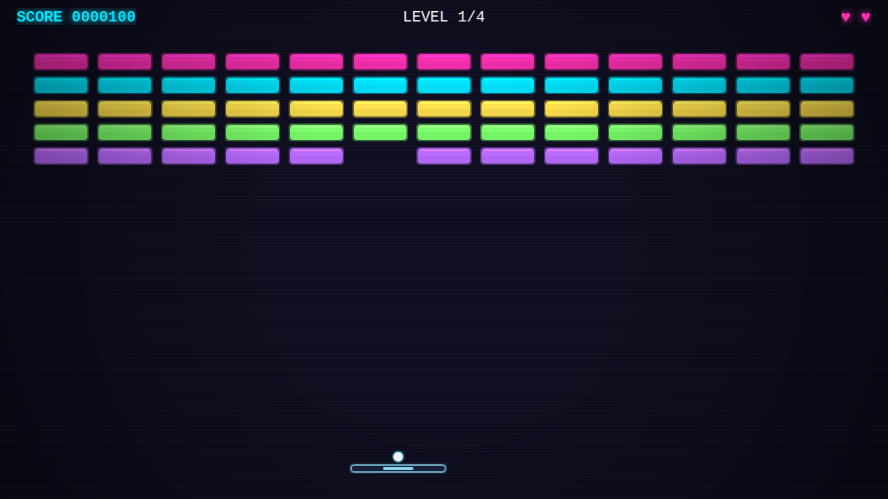

# NEON BREAKOUT

A neon-glow breakout game built with **Phaser 3 + TypeScript** — procedural
graphics, synthesized audio, zero external assets.



## Play

Open the deployed game on GitHub Pages (auto-deploys from `main`), or run it
locally:

```bash
npm install
npm run dev        # dev server → http://localhost:5173
npm test           # vitest unit tests (gameplay math/rules)
npm run build      # type-check + production build → dist/
```

## Controls

| Key | Action |
|---|---|
| ← / → or A / D | Move paddle |
| SPACE | Launch ball / restart after game over |
| ESC | Pause menu (resume / restart / quit) |
| M | Mute |

## Game

- **4 handcrafted levels** — rainbow warm-up, armored checkerboards, a vault of
  solid bricks, and a fortress you have to thread through the roof.
- **Steady difficulty ramp** — the ball speeds up with every paddle hit.
- **Power-up capsules** — wider paddle (10 s), multiball, slow-motion (8 s),
  extra life. Drops are visible in the HUD as timer bars.
- **Juice** — particle bursts, ball trails, screen shake, CRT scanlines and
  vignette, squash-and-stretch on the paddle.
- **5 lives** (up to 8 with life pickups), high score persisted in `localStorage`.

## Highlights for the curious

- **Everything is generated in code.** Textures are drawn with
  `Graphics.generateTexture` at boot (`src/scenes/BootScene.ts`); there is not
  a single image or audio file in this repo.
- **The soundtrack is generative.** A calm Am–F–Cmaj7–G pad loop with soft
  echoes, built from raw oscillators via the Web Audio API
  (`src/systems/audio.ts`). SFX are synthesized one-shots in the same module.
- **Game feel is pure math, so it's tested.** Paddle bounce angles, level-map
  parsing, scoring rules and power-up timers live in Phaser-free modules under
  `src/systems/` and are covered by unit tests (`tests/`).

## Tech

- [Phaser 3](https://phaser.io) — game engine
- TypeScript (strict) + Vite
- Vitest — unit tests for the pure gameplay logic
- GitHub Actions — CI runs tests + build, then deploys to Pages

## License

[MIT](LICENSE)
